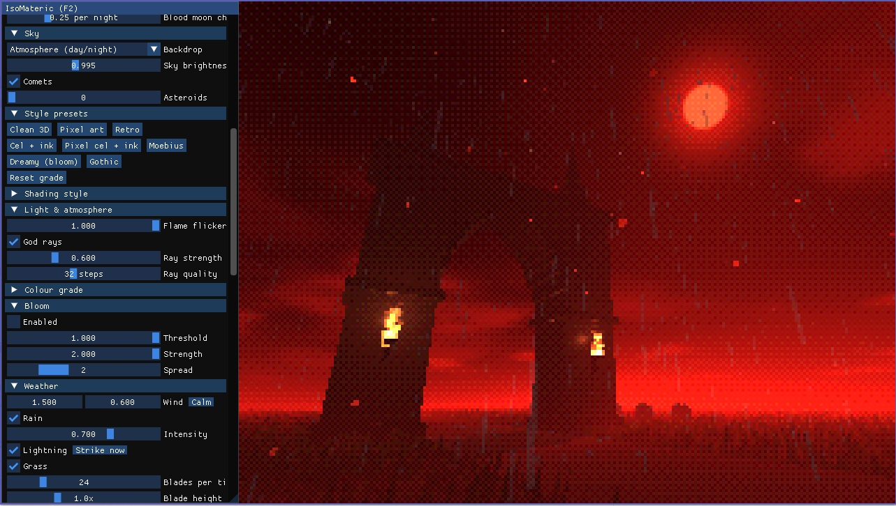
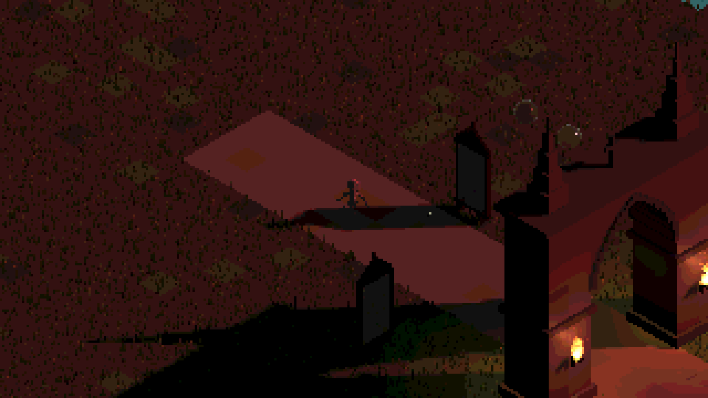

# IsoMateric




A small isometric engine in C++17 and OpenGL 3.3.

- **World**: block height-map levels, an in-game editor, plain-text level files
- **Rendering**: instanced blocks, directional shadows, up to 32 point lights, skinned glTF models,
  particles, refractive glass, planar mirrors, a pixelizer post-process, a see-through window in walls that hide
  the player
- **Atmosphere**: day/night cycle with blood moons, sky backdrops (atmosphere, galaxy, overcast),
  rain and lightning, wind-driven grass, fog, god rays, flickering torches, bloom, colour grading
- **Gameplay**: character controller with gravity, jumping and per-axis collision, A* click-to-move
  that climbs one block at a time; a Silent Hill style item screen (rotating 3D item icons,
  Equip / Examine / Read), pickups with highlights, and a flashlight (a spotlight)
- **Performance**: uncapped frame rate (VSync toggle), Very low / Low / Medium / High / Ultra presets and a
  frame-time readout in the sidebar
- **Engine**: ECS (EnTT), Lua 5.4 scripting, sound (miniaudio), skeletal animation (cgltf),
  hot reload of shaders and scripts, a built-in CPU profiler and optional Tracy integration

## Build

Needs CMake 3.16+, a C++17 compiler and, on Linux, the X11/OpenGL development headers
(`xorg-dev libgl1-mesa-dev` on Debian/Ubuntu). Every other library is in `external/`.

```sh
./compile_and_run.sh              # configure, build, run
./compile_and_run.sh my.level     # run with another level
ctest --test-dir build            # unit tests (level, physics, pathfinding, particles)
cmake -B build -DISOMATERIC_TRACY=ON   # with the Tracy profiler client
```

In VS Code: F5 builds and runs under the debugger, Ctrl+Shift+B only builds.

## Controls

| Input | Play mode | Editor mode |
|---|---|---|
| WASD / arrows | move | move |
| Space | jump | jump |
| Left click | walk to the tile (A*) | raise the column |
| Right click | | lower the column |
| Middle drag | pan the camera | pan the camera |
| Q / E | rotate the view | rotate the view |
| Wheel, + / - | zoom | zoom |
| T | follow the player on/off (on by default; panning turns it off) |
| Shift / Ctrl or C | sprint / crouch (hold); crouching is slower, lower, and cannot jump |
| F / Enter | pick up the item in reach, confirm in menus |
| I | item screen (pauses the game); Esc or I closes it |
| L | flashlight on/off, once equipped |
| F at a mirror | look into it: first person, facing the glass; F, S or Esc steps back | |
| Tab | switch to editor | switch to play |
| F2 | debug window | debug window |
| Esc | quit | quit |

The debug sidebar on the left (F2 toggles it, drag its right edge to resize) controls the camera style (true isometric or 2:1 dimetric), lighting, the
pixelizer, point lights, entities, audio volume and the profiler, and saves/loads levels.

## Looks

Everything below is a toggle for trying styles, not something meant to be on all at once. The
sidebar's **Style presets** switch between Clean 3D, Pixel art, Retro, Cel + ink, Pixel cel + ink,
Moebius and Dreamy (bloom); each value stays editable afterwards.

- **Shading**: smooth, cel (banded light), or Moebius (two flat tones with ink hatching in shadow)
- **Ink outlines**: drawn where surface normals turn or depth jumps, so a flat run of blocks stays
  clean and lines appear only on silhouettes and edges
- **Bloom**: bright pixels bleed light; applied before the pixelizer so the glow is pixelated too
- **Sky backdrop** (per level, `sky` line): plain colour, atmosphere (gradient, sun/moon, clouds,
  a sea of clouds below, stars and comets at night, follows the day/night cycle) or galaxy (Milky
  Way band, nebulae, a spiral galaxy, stars, comets). The camera is orthographic, so instead of a
  cubemap the sky is drawn from a virtual view that turns with the camera.

## Camera



Isometric is the default (true isometric or 2:1 dimetric). **V** toggles a first-person view for
testing; drag with the right or middle mouse to look around. In isometric, walls between the
camera and the player become see-through.

## Pixelizer

Renders the scene at `window / pixel size` and scales it up without filtering, so every scene
pixel becomes a crisp block; the UI stays at full resolution. Options: colour levels per channel
(posterize) with 4x4 Bayer dithering, and camera snapping to whole pixels so the image does not
shimmer while the camera moves.

## Day/night and weather

The sidebar's **Day / night** section starts a test cycle: the sun rises in the east at 6:00
and sets at 18:00 with warm light near the horizon, a cool moon lights the night, and ambient and
sky colour follow. Each night has a chance of a **blood moon** (or trigger one from the sidebar):
red pulsing moonlight, a crimson sky and fog, falling embers and an ominous sound until dawn;
scripts get `blood_moon_start` / `blood_moon_end` events. Stopping the cycle restores the level's own sun (saving a level while it runs also
saves the level's own sun). **Weather** adds rain (streaks around the camera, splashes on block
tops, wet darker surfaces with sharper highlights, a looping rain sound) and fog: a low mist that
drifts over the ground plus optional distance haze, coloured like the sky unless overridden.

## Glass

Glass spheres refract a copy of the frame drawn before them (screen-space, so they bend what is
behind them on screen), tint by Beer-Lambert absorption over their thickness, reflect a sky with
Schlick Fresnel, and blur with roughness. `dispersion` refracts red, green and blue with slightly
different IORs. The default script places a labelled test row along the right edge of the level;
each sphere's values can be edited live under Entities in the sidebar. Known limits: glass does not
cast shadows, and a sphere seen through another one shows the background, not the other sphere.

## Scripting

`assets/scripts/game.lua` runs on start and reloads when saved; entities a script spawned are
removed on reload. It can define `on_start()`, `on_update(dt)` and
`on_event(name, x, y, z)` (`"jump"`, `"land"`, `"respawn"`, `"blood_moon_start"`, `"blood_moon_end"`, `"pickup:<id>"`, `"mirror_look"` and `"mirror_leave"` with the mirror's position). The engine is the global `iso` table:

| Function | |
|---|---|
| `iso.spawn_model(path, x, y, z [, height, yaw_offset])` | glTF model as an entity, scaled to `height`; returns the entity |
| `iso.play_animation(e, clip [, speed])` | `speed` 0 pauses |
| `iso.set_position(e, x, y, z)`, `iso.get_position(e)` | |
| `iso.set_yaw(e, degrees)` | |
| `iso.set_tint(e, r, g, b)` | multiply a model's colours |
| `iso.spawn_emitter(preset, x, y, z)` | continuous particles: `"fire"`, `"smoke"`, `"sparkle"` |
| `iso.burst(preset, x, y, z)` | one-shot particles, e.g. `"dust"` |
| `iso.spawn_box(x, y, z, sx, sy, sz, r, g, b [, glow [, alpha [, emissive]]])` | decorative box (props, roofs, signs); no collision. `glow`: unlit; `alpha` < 1: see-through like glass (no shadow); `emissive` > 0: lit as usual plus its own glow, which blooms |
| `iso.spawn_box(x, y, z, sx, sy, sz, r, g, b, opts)` | same, with an options table: `glow`, `alpha`, `emissive`, `solid` (blocks the player: walls, ceilings, furniture), `reflection_only` (only visible in mirrors) |
| `iso.set_reflection_only(e, on)` | a box or model that only shows in mirrors (no shadow) |
| `iso.camera_zone(x0, y0, z0, x1, y1, z1, mode [, {force = true}])` | while the player's feet are inside, the camera switches to `"first_person"` or `"isometric"` (with a short fade) and switches back on leaving; `force` stops the player switching away |
| `iso.lock_camera(dx, dz [, pitch])`, `iso.unlock_camera()` | first person looking along (dx, dz), no walking, until unlocked (for interactions and scares) |
| `iso.spawn_pickup(id, x, y, z)` | an item to pick up with F: `flashlight`, `rusty_key`, `torn_note` (defined in `src/inventory.cpp`); sends the event `pickup:<id>` |
| `iso.has_item(id)` | whether the player carries the item |
| `iso.spawn_glass(x, y, z [, opts])` | glass sphere; `opts`: `radius`, `ior`, `roughness`, `absorption`, `dispersion`, `tint = {r, g, b}`, `label` |
| `iso.spawn_mirror(x, y, z, w, h [, yaw [, opts]])` | vertical mirror centred at x, y, z; `yaw` in degrees (0 faces +z, 90 faces +x); `opts`: `tarnish` (0..1), `tint = {r, g, b}`, `label`. Reflects blocks, grass and models; each visible mirror redraws the world once (up to 4) |
| `iso.destroy(e)`, `iso.player()` | |
| `iso.play_sound(name [, volume])` | plays `assets/sounds/<name>.wav` |
| `iso.height(x, z)` | column height |
| `iso.light_count()`, `iso.get_light(i)`, `iso.set_light_intensity(i, v)` | 1-based |
| `iso.time()`, `iso.log(...)` | |

## Levels

Plain text, see `assets/levels/default.level`:

```
size 16 16                      # columns along x and z
spawn 12 3                      # player start tile
sun -0.4 -1 -0.25  1 0.95 0.85  # direction, colour
ambient 0.3
light 5.5 2.5 8  1 0.55 0.25  1.2 6   # position, colour, intensity, radius (max 32)
sky galaxy                      # plain | atmosphere | galaxy
script scripts/game.lua         # the level's Lua script
asteroids 40                    # block asteroids orbiting the level
trunk 10 10                     # an endless tree trunk through that column
tiles                           # optional: one row of materials per x
..ssgg...                       # . default, s stone, S dark stone, g grass, w wood, d dirt, r rock, b plaster
heights                         # one row per x; 0 = hole, 1 = floor, each extra = one block up
1 1 1 ...
```

The player can climb one block by jumping; falling into a hole respawns them.
`assets/levels/sky_island.level` is a floating town square in space: a paved square around an
endless tree, a house, wooden bridges (start at the end of one), lamps, signs, benches, an NPC to
talk to and a rocky underside, under a galaxy sky with asteroids. Its props are built in
`assets/scripts/sky_island.lua` with `iso.spawn_box`.

## Layout

```
src/
  level, player, pathfinding, particles   game logic without OpenGL (isomateric_core, unit-tested)
  renderer, shader, texture, model        OpenGL, glTF loading and skinning
  camera, input, audio, scripting         isometric camera, input actions, miniaudio, Lua
  components                              ECS components
  isomateric                              main loop, systems, editor, debug UI
assets/   shaders, levels, models, sounds, scripts
external/ vendored glfw, glad, glm, imgui, stb, entt, cgltf, miniaudio, lua, tracy
tests/    unit tests
```

## Credits

- `assets/models/CesiumMan.glb`: © 2017 Cesium, [CC BY 4.0](https://creativecommons.org/licenses/by/4.0/),
  from the [Khronos glTF sample assets](https://github.com/KhronosGroup/glTF-Sample-Assets)
- Sounds in `assets/sounds` are synthesized for this project
- Libraries in `external/` keep their own licenses (MIT / zlib / BSD / public domain)
